# Etapa 06 aplicada ao Joille — guia e revisão

> A auditoria posterior executou também gravações reais e corrigiu o preço zero
> no backend. Consulte [o checklist e os resultados atuais](SE2-Etapa06-Auditoria.md).

Revisão em 24/09/2026 do [enunciado original](https://github.com/sorfabiosantos/acme-3am/blob/main/SE2-Etapa06-JavaScriptOrientadoObjetos.md).
O escopo é a Etapa 06 completa, incluindo a parte prototípica: os exemplos de
produtos do ACME correspondem aos serviços de joalheria do Joille.

## O que já existia e o que mudou nesta revisão

O projeto já tinha as classes de domínio, serviços HTTP e componentes prototípicos
integrados às telas públicas, do cliente e administrativas. Eles foram preservados.

- Criada a branch `javascript-poo` a partir do HEAD local `2419af5`, preservando
  todas as alterações locais existentes. Não houve commit nem publicação. O estado
  estável da Etapa 05 não foi identificado separadamente no histórico.
- `ApiService.toPayload()` agora aceita entidades e objetos simples no Node sem
  tentar acessar `HTMLFormElement`, que só existe no navegador. Formulários reais
  e `FormData` continuam aceitos no navegador.
- `Toast.variantFor()` agora respeita `type: "warning"`, mesmo sem código 400.
  Sucesso é verde; aviso é amarelo; erro é vermelho. Erro 400 continua amarelo.
- Categorias e FAQs administrativas usam `escapeHtml()` para apresentar o texto
  das entidades sem interpretar marcação HTML digitada nos campos.
- Adicionado `http-contract-test.mjs`, que exercita os métodos HTTP reais dos
  serviços com respostas simuladas, sem gravar no banco.

## Onde cada requisito está aplicado

| Requisito | Implementação em `views/assets/_common/` | Uso real |
|---|---|---|
| Classes e encapsulamento | `classes/entities/Entity.js` e subclasses | Serviços, categorias, FAQs, tipos de FAQ, usuários, imagens e contatos |
| Construtores e validações | `Service`, `Category`, `Faq`, `User` etc. | `new Service(values)` valida os valores do formulário |
| Getters e métodos de domínio | `formattedValue`, `isActive`, `resume`, `firstName` | Preço em BRL, status, resumos e saudações |
| Conversão API ↔ objeto | `fromApi`, `collectionFromApi`, `toJSON`, `toFormData` | `categories_id` da API vira `categoriesId` no JavaScript |
| Herança HTTP | `HttpClientBase → ApiService → ServiceService` | CRUD de serviços, categorias e FAQs; usuários adaptam suas rotas |
| Autenticação | `setAuthToken` e `UserService` | Bearer no cabeçalho; login via POST; atualização de perfil via PUT |
| Protótipos | `prototypes/Toast.js`, `FormController.js`, `CrudController.js` | Mensagens, formulários e CRUD reutilizados nas telas |
| Composição | `CrudController` recebe serviço, formulário e toast | Cada tela configura seus colaboradores e seu template |
| Estados da interface | `scripts/ui.js` e `FormController.setBusy` | Carregando, vazio, falha, botão ocupado e confirmação de sucesso |

## Como salvar um serviço funciona

```mermaid
flowchart LR
    A[Formulário] --> B[FormController: valida campos]
    B --> C[Service: valida e encapsula dados]
    C --> D[CrudController: criar ou atualizar]
    D --> E[ServiceService / ApiService]
    E --> F[HttpClientBase: HTTP e token]
    F --> G[API PHP e banco]
    G --> H[Resposta convertida em entidade]
    H --> I[Toast e atualização da lista]
```



1. A tela `views/assets/admin/scripts/edit_services.js` monta um `CrudController`.
2. Ao salvar, o formulário verifica os campos. O construtor `Service` passa cada
   valor pelos setters; nome vazio ou preço negativo geram uma mensagem amarela.
3. Sem `id`, o controller chama `create`; com `id`, chama `update`.
4. O serviço converte a entidade em payload. Cadastro usa POST multipart;
   edição usa PUT com campos codificados como formulário, conforme o backend PHP.
5. `HttpClientBase` envia a requisição com o token. Somente essa camada usa `fetch`.
6. `ApiService` converte o JSON recebido em `Service`. A tela mostra a mensagem,
   fecha o modal após sucesso e recarrega a lista. A exclusão do CRUD é inativação.

## Exemplo de POO clássica

```js
import Service from "./views/assets/_common/classes/entities/Service.js";

const joia = new Service({
    categories_id: 1, name: "  Polimento  ",
    description: "Polimento de anel", value: "150.50"
});
console.log(joia.name);           // "Polimento"
console.log(joia.formattedValue); // moeda brasileira
console.log(joia.isNew);          // true: ainda não tem id
console.log(joia.toJSON());       // campos no formato esperado pela API
joia.value = -10;                 // RangeError: setter impede preço negativo
```

`#name` e `#value` são campos privados; a leitura e escrita públicas passam pelos
getters e setters. `Service extends Entity` reaproveita id, identificação de novos
registros e conversão. JavaScript implementa também a sintaxe `class` sobre sua
cadeia de protótipos; a diferença didática é a forma de declarar e organizar objetos.

## Exemplo de protótipos e composição

```js
import { createToast } from "./views/assets/_common/prototypes/Toast.js";

const curto = createToast();
const longo = createToast({ duration: 8000 });
console.log(curto.show === longo.show); // true: função compartilhada
console.log(curto.duration === longo.duration); // false: estado independente
```

O `CrudController` reúne objetos de formulário, serviço e toast por composição.
Não precisa herdar deles. Categorias e FAQs usam o mesmo controller, trocando a
entidade, serviço, campos e apresentação. Serviços e entidades não desenham HTML.

## Verificações executadas nesta revisão

Na pasta `joille2`, execute:

```sh
node poo-test.mjs
node --test http-contract-test.mjs
node image-test.mjs
```

- POO: **159 asserções aprovadas**, nenhuma falha.
- Contratos HTTP: **9 testes aprovados**, incluindo CRUD de três recursos, login,
  perfil, token, multipart, PUT, paginação, falhas de rede e cores das mensagens.
- Imagens: suíte aprovada (validação, respostas fora de ordem, fechamento e envio duplicado).
- API local: GET de serviços, categorias, FAQs e tipos de FAQ retornou HTTP 200
  com `type: success` (respectivamente 5, 3, 8 e 3 registros nesta execução).
- Navegador: catálogo carregou e o filtro Avançado reduziu a lista ao serviço
  dessa categoria; login administrativo chegou ao dashboard; a lista de categorias
  carregou e Editar preencheu o nome existente; a listagem administrativa de FAQs
  carregou as oito perguntas. O formulário de edição foi cancelado sem salvar.

Os testes HTTP simulam o transporte; não comprovam por si só a gravação no banco.
A suíte PHP completa não foi executada nesta revisão: sua limpeza remove todos
os registros `ZZ ` / `zz.*`, inclusive preexistentes, e também exercita e-mail e
alterações de perfil. As contagens antigas do arquivo de evidências são históricas.

## Como demonstrar pela interface

Com Apache e MySQL do WAMP ativos e o banco existente configurado:

1. Abra [Serviços](http://localhost/projeto/joille2/services) e alterne a categoria.
   A lista trabalha com entidades `Service`; o valor vem de `formattedValue`.
2. Abra [Login administrativo](http://localhost/projeto/joille2/admin/login) e use
   uma conta administradora local. As credenciais de desenvolvimento estão no README.
3. Entre em Serviços e abra Novo Serviço. Experimente um campo obrigatório vazio
   antes de salvar um registro de demonstração com nome único.
4. Edite esse registro e observe os valores preenchidos; ao salvar, ocorre PUT.
   Ao excluir, confirme apenas seu registro de demonstração: ele será inativado.
5. Repita em Categorias e FAQs para mostrar o mesmo controller com outras classes.
6. Consulte `http-contract-test.mjs` para ver as verificações reproduzíveis sem
   alterar os registros do banco.

Os passos de criação, edição e exclusão acima são um roteiro para demonstração,
não uma declaração de que foram executados no navegador nesta revisão.
