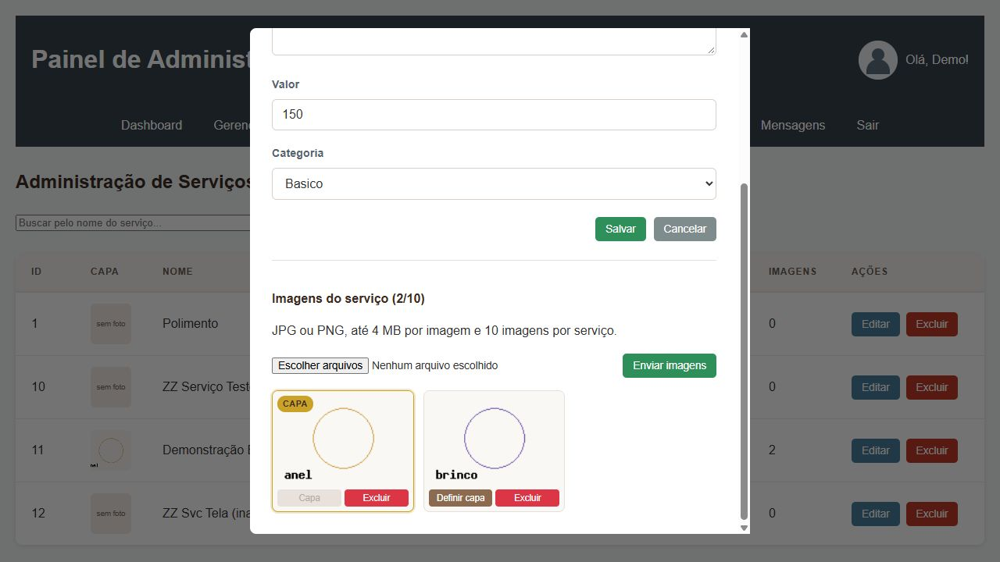

# Etapa 07 — imagens do Joille

O item do catálogo do Joille é um **serviço de joalheria**. A tabela existente
`service_images` tem uma linha por imagem e uma chave estrangeira de `services_id`
para `services.id`. Um serviço pode começar sem fotos. O banco guarda metadados e
caminhos relativos; o arquivo processado fica em `uploads/images/AAAA/MM/`.

## Como demonstrar

1. Inicie o WAMP (Apache e MySQL). Siga a [instalação](readme.md#instalação) e
   confira se o banco tem a [migração das imagens](banco%20de%20dados%20atualizado/migration-002-images-mail-reports.sql).
   Se já importou o dump atual, não aplique a migração novamente.
2. Entre como cliente e abra [Perfil](http://localhost/projeto/joille2/app/).
   Selecione um PNG ou JPEG, confira a prévia e clique em **Atualizar Foto**.
   Recarregue: a imagem no cabeçalho vem da foto persistida do usuário.
3. No [painel administrativo](http://localhost/projeto/joille2/admin/editar-servicos),
   edite um serviço já salvo. Selecione duas imagens e confira as prévias antes de
   clicar em **Enviar imagens**. Recarregue a página e reabra o serviço.
4. No [catálogo público](http://localhost/projeto/joille2/services), clique em
   **Ver fotos (2)**. A galeria pública não exibe controles de exclusão.
5. De volta ao painel, exclua uma foto de demonstração e confira que a outra
   permanece. A inativação do serviço pela rota DELETE limpa sua galeria.

## Contrato e armazenamento

Consulte o [README da API](api/readme.md) para as rotas e permissões.
`POST /users/photo` recebe `photo` e identifica o cliente pelo token;
`POST /service-images/{serviceId}` recebe `images[]` e exige administrador.
O frontend usa FormData, com o boundary definido pelo navegador. Cada lote tem no
máximo 10 imagens contando as já existentes; cada arquivo aceita até 4 MB e a
imagem decodificada até 12 megapixels. O backend confere tamanho, MIME e conteúdo.

`Source/Support` corresponde à pasta **source/Support** do projeto. O adaptador
`ImageUploader` chama `Source\Support\Upload::image()`, da referência ACME, antes
de usar o redimensionamento do Joille. A cópia temporária é removida no fim; só a
imagem reprocessada com nome gerado fica na pasta pública. Upload de perfil: até
600 px de largura. Galeria: até 1600 px. São necessários PHP com GD, fileinfo e
PDO MySQL, escrita em uploads e na pasta temporária. No WAMP com mod_php,
`api/.htaccess` configura upload_max_filesize=4M e post_max_size=44M. Em FPM,
aplique esses limites e max_file_uploads>=10 no php.ini ativo e reinicie o PHP.

O lote é uma operação única: se um arquivo for inválido ou uma inserção falhar,
os arquivos novos são removidos e os metadados não são confirmados. A substituição
de foto bloqueia o perfil enquanto grava; a anterior só é removida após o commit.
A exclusão de uma imagem verifica o par serviço/imagem. A aplicação também remove
os arquivos ao inativar o serviço; a FK por si só limparia apenas metadados.

## Evidências — 04/11/2026

Verificações executadas com Apache, PHP 8.3.28 e MySQL 8.4.7 em **banco temporário
isolado**, inicializado a partir do SQL de demonstração do projeto.

| Caso exercitado | Resultado observado |
|---|---|
| Perfil no navegador | A prévia apareceu antes do envio. A foto salva reapareceu com o mesmo caminho após recarregar. |
| Galeria no navegador | Estado vazio → duas prévias → envio → duas miniaturas após recarregar e reabrir. O catálogo público também mostrou ambas. |
| Autorização | Sem token: 401. Cliente tentando alterar a galeria: 403. ID enviado junto da foto não mudou a identidade do perfil atualizado. |
| Validação | Upload ausente ou acima do limite foi recusado. Um lote com um PNG real e texto disfarçado de PNG não alterou o banco nem o conjunto de arquivos. |
| Falha de banco | Uma restrição NOT NULL foi violada intencionalmente por gatilhos temporários: a API devolveu 500, preservou a foto anterior e não deixou arquivos novos. |
| Relação 1:N e remoção | Duas linhas para o mesmo serviço, nomes distintos e URLs HTTP 200. Outro serviço retornou lista vazia. Excluir usando o serviço errado retornou 404. Excluir a primeira imagem preservou a segunda; inativar o serviço removeu a restante do banco e do disco. |

[Prévia da foto do cliente](evidencias/etapa07/perfil-previa.jpg) · [Galeria pública](evidencias/etapa07/catalogo.jpg)

## Reproduzir os testes

- `node image-test.mjs`: validação, requisições fora de ordem e envio duplicado.
- `node poo-test.mjs`: 159 asserções aprovadas.
- `node --test http-contract-test.mjs`: 9 testes aprovados.
- `php api-test.php`: 146 verificações aprovadas no ambiente descartável.
  A limpeza dessa suíte é abrangente; não execute no banco com dados de uso.
- `node tests/imagens-integracao.mjs`: teste real de persistência, autorização,
  falhas de escrita e compensação dos arquivos. Só prossiga com um MySQL de
  testes separado na porta local 3306, usando o banco `joille` do dump. Defina
  `JOILLE_MYSQL` (executável do cliente), `JOILLE_TEST_DATADIR` (diretório do
  MySQL isolado no formato `joille-images-<hex>/db`), `JOILLE_TEST_PNG`
  (arquivo PNG de teste), `JOILLE_ADMIN_EMAIL` e `JOILLE_ADMIN_PASSWORD`.
  O script compara o diretório com `@@datadir` antes de inserir dados ou criar
  gatilhos; usa o usuário root da instância descartável, sem senha.
